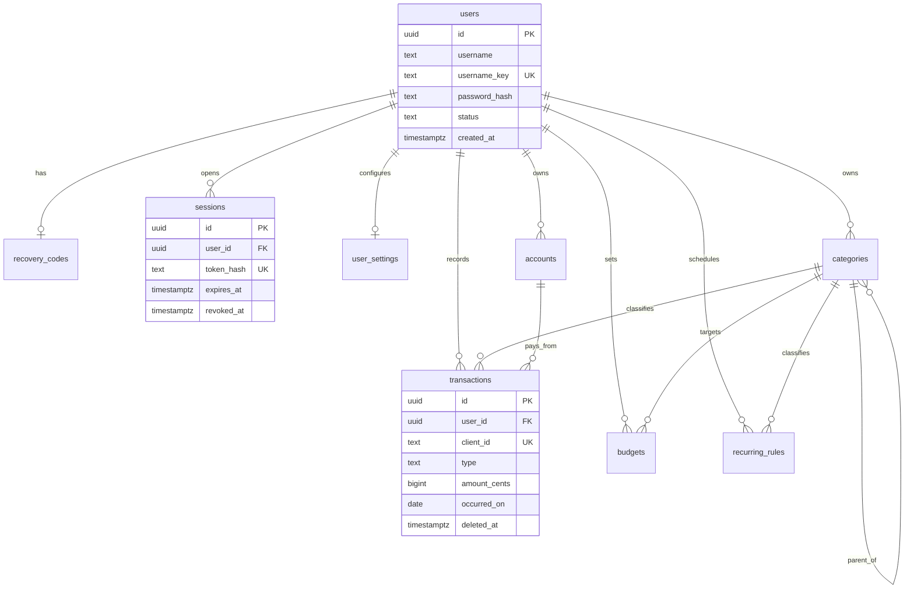

# 轻记 · 数据库设计（PostgreSQL / MySQL）

对应产品文档：`001.产品 PRD（产品经理）/轻记-个人记账Web应用-PRD-v1.1.1.md`
对应前端原型：`003.前端代码/frontend/`
数据库脚本：

- `schema.sql`：PostgreSQL 14+
- `schema.mysql.sql`：MySQL 8.0+

## 0. 当前本地数据库（MySQL，已执行）

当前已启动一个独立的 MySQL 容器，Navicat 可直接连接：

| 配置项 | 值 |
| --- | --- |
| 容器 | `qingji-mysql` |
| 镜像 | `mysql:9.7.0` |
| 主机 | `127.0.0.1` |
| 端口 | `3307` |
| 数据库 | `qingji` |
| 用户名 | `qingji` |
| 密码 | 本地初始化时设置（不写入仓库） |
| SSL | 不使用 |

Navicat 新建连接时请选择 **MySQL** 类型（不是 PostgreSQL），使用上述参数。数据库已创建：

- 12 张业务表：`identity_*` 4 张、`ledger_*` 7 张、`schema_migrations` 1 张
- 2 个视图：`ledger_v_monthly_summary`、`ledger_v_category_spending`
- 19 条默认分类模板
- 6 个存储过程、8 个触发器

> `3307` 是轻记专用端口；宿主机现有的 `3306` MySQL 容器没有被修改。PostgreSQL 版本仍保留在 `127.0.0.1:5432`，二者互不影响。
> 以上密码仅用于本地开发，不应复用到生产环境。

## 1. 范围与边界

本项目采用**认证数据与账本数据分离**的设计：

| Schema | 版本状态 | 内容 | 说明 |
| --- | --- | --- | --- |
| PostgreSQL `identity` / MySQL `identity_*` | **v1.1.1 启用** | 用户、恢复码、会话、登录审计 | 只保存认证数据，不保存金额、备注、分类或账目 |
| PostgreSQL `ledger` / MySQL `ledger_*` | **当前 MySQL 实现已启用** | 设置、分类、账户、账目、预算、周期规则 | 原 PRD v1.1.1 计划账本本地；当前前后端已改为本地 MySQL 账本 |
| PostgreSQL `public` / MySQL 同库 | 通用 | `schema_migrations` | 迁移版本记录 |

当前实现状态：

- 账号与账目都写入本地 MySQL（127.0.0.1:3307）；
- 登录只证明身份，不代表多设备云同步；
- 当前没有远程云同步；MySQL 只运行在本地 Docker 容器中；
- 未来云同步仍需要单独的授权、加密与冲突合并设计。

## 2. 技术约定

两版共同约定：

- 金额统一使用 **整数分**（`BIGINT`），避免浮点误差。单笔上限 `999,999,999` 分，即 `¥9,999,999.99`。
- `occurred_on` 使用本地业务日期；账目时间与审计时间由应用/数据库记录。
- 删除采用软删除：分类和账目使用 `deleted_at`；账户使用 `archived`。
- 用户数据表都带 `user_id`，并级联到用户主表。
- 密码哈希、恢复码哈希、会话 Token 哈希不可逆；应用不得保存明文。

**PostgreSQL 版：**

- PostgreSQL **14+**；UUID 使用 `gen_random_uuid()`，依赖 `pgcrypto`。
- 使用 `identity`、`ledger` 两个 schema；数组字段使用原生数组；部分索引使用 `WHERE deleted_at IS NULL`。
- `updated_at` 由触发器维护。

**MySQL 版：**

- MySQL **8.0+**（当前验证版本 MySQL 9.7.0），InnoDB，`utf8mb4`。
- 使用表名前缀区分逻辑域：`identity_*`、`ledger_*`。
- UUID 使用 `CHAR(36)`，默认 `UUID()`；数组字段使用 `JSON`；部分唯一约束用生成列模拟。
- `updated_at` 使用 `ON UPDATE CURRENT_TIMESTAMP(3)`。
- 跨表校验使用存储过程 + `BEFORE INSERT/UPDATE` 触发器。
- 由于 MySQL 开启 binlog 时创建触发器需要较高权限，`schema.mysql.sql` 已由容器 root 执行；业务账号 `qingji` 用于连接和查询。
- 不使用数据库枚举类型，改用 `VARCHAR + CHECK`，便于后续迁移。

## 3. 表设计总览

> PostgreSQL 使用 `identity.users` 等 schema 表名；MySQL 对应表名为 `identity_users` 等。以下结构描述对两版通用。

### 3.1 `identity`：认证域（v1.1.1）

| 表 | 主要字段 | 作用 |
| --- | --- | --- |
| `identity.users` | `id`, `username`, `username_key`, `password_hash`, `status`, `failed_attempts`, `locked_until`, `last_login_at` | 账号主表；只收用户名与密码 |
| `identity.recovery_codes` | `user_id`, `code_hash`, `created_at`, `used_at` | 恢复码哈希；每个账号一条，重置时覆盖 |
| `identity.sessions` | `user_id`, `token_hash`, `expires_at`, `revoked_at`, `ip_hash`, `user_agent_hash` | 30 天服务端会话；Cookie 只放随机会话 ID |
| `identity.auth_attempts` | `username_key`, `ip_hash`, `action`, `success`, `created_at` | 登录/注册/找回限流与安全审计 |

**设计要点：**

- 用户名保留原始大小写；`username_key = lower(btrim(username))` 用于不区分大小写判重。
- 应用写入前必须做 NFKC 归一化；数据库负责长度、首尾空格、空白/控制字符和唯一性兜底。
- `password_hash` 保存 Argon2id 编码串或 bcrypt cost ≥ 12；绝不保存明文。
- 恢复码只存哈希；明文只在生成时展示一次。
- 会话 30 天；登录成功轮换会话 ID；修改密码吊销其他会话。
- 删除账号级联删除会话、恢复码；`auth_attempts` 不含用户外键，建议保留 90 天后清理。

### 3.2 `ledger`：当前本地账本域

| 表 | 主要字段 | 作用 |
| --- | --- | --- |
| `ledger.user_settings` | `currency`, `timezone`, `last_type`, `privacy_mode`, `backup_reminder`, `recent_category_ids`, `sync_enabled` | 账号级偏好与同步开关 |
| `ledger.category_templates` | `key`, `parent_key`, `name`, `type`, `icon`, `color`, `sort` | 系统默认一级分类模板 |
| `ledger.categories` | `user_id`, `parent_id`, `name`, `type`, `icon`, `color`, `sort`, `is_system`, `hidden`, `deleted_at` | 用户分类；最多两级 |
| `ledger.accounts` | `user_id`, `name`, `type`, `initial_balance_cents`, `include_in_total`, `archived` | 现金/微信/支付宝/银行卡等资金账户 |
| `ledger.transactions` | `user_id`, `client_id`, `type`, `amount_cents`, `currency`, `category_id`, `account_id`, `to_account_id`, `note`, `occurred_on`, `source`, `tags`, `deleted_at` | 账目主表，支持支出/收入/转账 |
| `ledger.budgets` | `user_id`, `period_start`, `period_end`, `scope`, `category_id`, `amount_cents`, `alert_thresholds` | 总预算与分类预算 |
| `ledger.recurring_rules` | `user_id`, `type`, `amount_cents`, `category_id`, `frequency`, `interval_count`, `next_run_on`, `enabled` | 周期记账规则（后续能力） |

**关键规则：**

- 一个账目必须属于一个分类；转账不能有分类，必须有转出/转入账户且两者不同。
- 事务触发器校验分类、账户是否属于同一用户，分类类型是否与账目类型一致，以及分类是否已删除。
- 分类最多两级；父分类必须属于同一用户、同一收支类型，不能自引用。
- 分类同级名称不区分大小写唯一；删除后可重新使用同名分类。
- `client_id` 由客户端生成，`UNIQUE (user_id, client_id)` 保证同步幂等。
- 账目与分类、账户之间的删除策略为 `RESTRICT`；业务上先迁移再删除。
- 预算的 `period_start` / `period_end` 支持自然月与未来自定义账期。

### 3.3 视图

| 视图 | 作用 |
| --- | --- |
| `ledger.v_monthly_summary` | 按用户、月份、收支类型汇总金额与笔数 |
| `ledger.v_category_spending` | 按用户、月份、分类汇总金额与笔数 |

视图过滤软删除记录，可直接供统计页或报表服务使用。

## 4. ER 关系



## 5. 与当前前端数据的映射

当前前后端已接入本地 MySQL；下表说明前端本地数据与数据库字段的对应关系。

| 前端存储 | 前端字段 | 服务端表/字段 |
| --- | --- | --- |
| `qingji_demo_accounts_v1` | `username`, `createdAt`, `salt`, `passwordHash`, `recoveryCode` | `identity.users` + `identity.recovery_codes`；salt/hash 由服务端重新生成，不迁移明文 |
| `qingji_demo_session_v1` | `usernameKey`, `expiresAt` | `identity.sessions`；Token 改为 HttpOnly Cookie |
| 旧前端本地 `qingji_demo_transactions_v1_<user>` | `id`, `type`, `amountCents`, `category`, `note`, `date`, `createdAt` | 已迁移到 `ledger.transactions`；分类名映射为 `category_id`，`client_id` 使用原 id |
| 本地默认分类 | 名称/图标/颜色/二级结构 | `ledger.categories`；由 `ledger.bootstrap_user(user_id)` 复制一级模板 |
| 本地偏好 | 隐私模式、备份提醒、上次收支类型 | `ledger.user_settings` |
| 备份 JSON | `qingji-backup` v1 | 不建表；导出/导入仍由客户端完成，云同步上线后再单独设计导入通道 |

### 初始化用户账本（仅云同步时）

**PostgreSQL：**

```sql
SELECT ledger.bootstrap_user('<user_uuid>'::uuid);
```

**MySQL：**

```sql
CALL ledger_bootstrap_user('<user_uuid>');
```

两者都会创建用户设置并复制一级默认分类。当前后端在首次读取账本/分类时调用；PostgreSQL 版用于保留的备选实现。

## 6. 执行方式

### 6.1 MySQL（当前本地环境）

```bash
# 已通过 Docker 创建数据库 qingji
# 连接参数见第 0 节
mysql -h 127.0.0.1 -P 3307 -u qingji -p qingji < schema.mysql.sql
```

如果是从空库初始化，建议用有建表/建触发器权限的账号执行；本环境已完成执行。

### 6.2 PostgreSQL

```bash
createdb qingji
psql -v ON_ERROR_STOP=1 -d qingji -f schema.sql
```

```bash
psql -d qingji -c "\dt identity.*"
psql -d qingji -c "\dt ledger.*"
psql -d qingji -c "\dv ledger.*"
```

两版脚本都使用 `IF NOT EXISTS` / `CREATE OR REPLACE` / `DROP ... IF EXISTS` 保持基本幂等，但**不是完整迁移系统**。后续结构变更请新增版本化迁移脚本，不要直接修改已上线的 `004-001`。

## 7. 安全与运维建议

- 数据库账号分离：应用账号只授予所需 schema 的 `USAGE` 与表级 `SELECT/INSERT/UPDATE/DELETE`；迁移账号单独管理。
- 生产建议启用 TLS、审计日志与定期加密备份。
- `identity.auth_attempts` 建议按 90 天保留并定期归档；会话过期记录也要清理。
- `sessions.token_hash`、`recovery_codes.code_hash`、`users.password_hash` 禁止出现在应用日志。
- 若提供服务端账本：PostgreSQL 可启用行级安全（RLS）；MySQL 没有原生 RLS，必须由应用层严格校验 `user_id`，或通过独立数据库/账号隔离。当前两版脚本都没有默认启用 RLS。
- 云同步若采用端到端加密，应在应用层加密金额/备注；数据库只保存密文，且需要单独的密钥管理设计。
- 账号注销：`identity.users` 删除会级联删除该用户的 sessions、recovery codes 及预留账本数据；账本是否保留需在应用层单独确认。
- 备份策略：数据库备份与应用侧 JSON 备份是两套机制，不能互相替代。

## 8. 待确认事项

1. `ledger` 表已随当前 MySQL 实现启用；PostgreSQL 版是否保留作为备选部署方案？
2. 云同步是否采用端到端加密；若采用，金额/备注字段需要改为密文字段设计。
3. 账号注销后，服务端账本数据是级联删除还是保留 30 天？当前外键为 `ON DELETE CASCADE`。
4. 会话与登录失败记录的保留周期是否按 30 天 / 90 天执行。
5. 是否需要行级安全（RLS）、数据库审计和独立只读报表账号。
